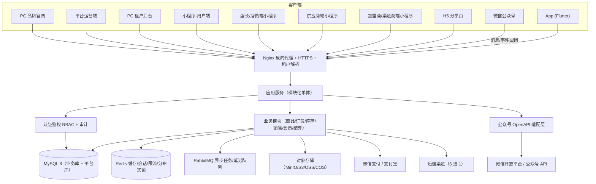
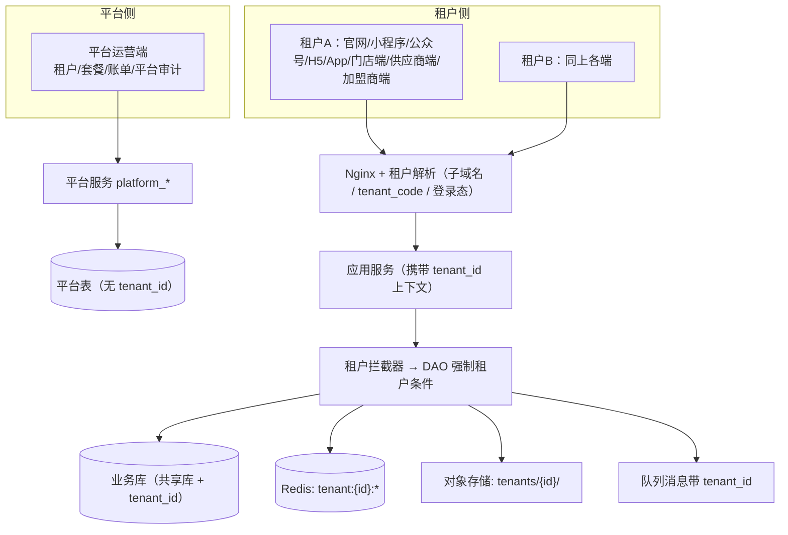
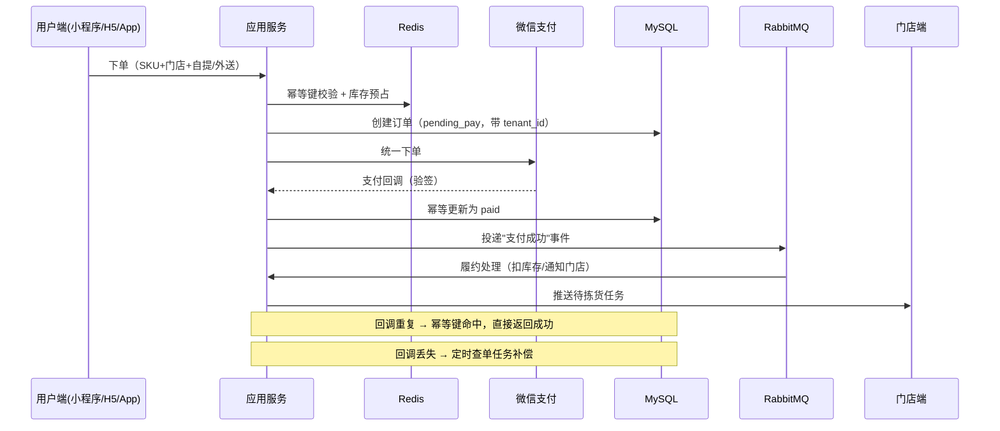

# 零售便利连锁 数字化多端平台 PRO.md

> **品牌背景**：面向**社区便利店/便利连锁**（直营 + 加盟混合）的多租户 SaaS 平台。覆盖「总部—区域—门店—供应商—加盟商—消费者」六方角色，打通商品、订货、收货、库存、收银、会员、线上到家、供应链结算全链路。行业特征：门店小而密、SKU 多而周转快、鲜食与短保商品多、加盟与直营混合、总部强管控 + 门店强执行。
>
> **项目名称**：零售便利连锁SaaS平台
>
> **产品矩阵（本次全部生成）**：PC 品牌官网（SEO 自适应） + **平台运营端（SaaS 控制台，独立后台）** + PC 租户后台（连锁总部后台） + **微信公众号（完整运营管理 11 子页）** + 小程序·用户端（会员/到店到家） + H5 分享页 + **店长/店员端小程序（业务一线端）** + **供应商端小程序** + **加盟商/渠道商端小程序** + **独立 App（Flutter，iOS+Android）** + 对象存储层 + 多语言 i18n 层 + 菜单可视化配置层
>
> **上线模式**：一次性完整上线，不分一期二期
>
> **存储方案**：抽象对象存储驱动层，支持本地磁盘 / AWS S3 / 阿里云 OSS / 腾讯云 COS / MinIO 五驱动，后台可视化切换，保存实时生效，不改代码。商品图、门店图、资质文件、合同扫描件、对账单、素材图片全部写入选中存储，路径带租户前缀 `tenants/{tenantId}/`。
>
> **架构说明**：前后端分离，对标【中医馆数字化平台（公众号 + 小程序 + PC 官网 + 后台管理）】架构体系，保留 RBAC 多角色权限、全操作审计日志、UnionID 会员互通、多驱动对象存储、多语言 i18n、菜单可视化、系统参数可视化、富文本 CMS；在此基础上叠加 **多租户 SaaS**（平台运营端 + 租户后台双后台、`tenant_id` 行级隔离、套餐配额、租户生命周期）、**公众号运营管理完整 11 子页**、**动态多端矩阵（一后端多前端壳）**。剔除全部医疗、预约挂号相关模块。
>
> **强制约束**：本系统产出**只做多租户 SaaS**，不产单商户自用版本；平台运营端（管租户）+ 租户后台（管业务）双后台为硬性形态，四件套（租户域模型 / `tenant_id` 隔离 / 套餐配额 / 生命周期）缺一即返工。

## 核心约束（代码强制约束）

1. **多租户隔离最高优先级**：所有业务表 `tenant_id` NOT NULL + 复合索引；DAO 层强制注入租户条件（MyBatis-Plus `TenantLineInnerInterceptor`）；手写 SQL 也必须带；跨租户查询视为越权，返回 403 + 安全审计。
2. **两级权限彻底分离**：平台超管/平台运营/平台财务 ↔ 租户管理员及业务角色；平台端菜单不得出现在租户后台，租户管理员访问平台端接口一律 403。
3. **超管全量维护红线**：除「审计日志」只读外，租户管理员对本租户所有业务模块均具备完整 CRUD；平台超管对平台侧模块完整 CRUD。
4. **行业合规红线**：
   - **食品经营**：《食品经营许可证》公示；预包装食品标签信息（品名/配料/净含量/生产日期/保质期/贮存条件/生产者）在商品详情完整展示；冷藏冷冻商品冷链温度要求与到货验收记录留痕；临期/过期商品下架与报损流程强制可追溯。
   - **烟草**：如销售卷烟，须持《烟草专卖零售许可证》，线上不得销售卷烟（仅门店线下），商品详情标注"线下门店购买"；禁止面向未成年人营销。
   - **价格与促销**：明码标价，促销价必须有原价依据与生效区间；禁止虚构原价。
   - **加盟与结算**：加盟商分账规则、保证金、违约条款在系统中可配置且合同留档。
   - **隐私与营销**：《个人信息保护法》——手机号加密存储、脱敏展示；营销短信/公众号消息须有订阅授权与退订入口。
5. 用户隐私：手机号/身份证/银行卡等敏感字段加密存储、展示脱敏；全操作审计日志可追溯（留存 ≥ 180 天）。
6. 多语言：默认简体中文 + English，后台可启用/停用更多语言；商品名、文章、页面文案按语言独立录入。
7. 菜单全部可视化：PC 官网导航、后台导航、小程序 tabBar、H5 底部导航、**公众号自定义菜单**全部后台拖拽编辑，实时生效无需发版。
8. **金额、比例、折扣、佣金、运费、库存阈值、临期天数、自动补货系数全部后台可配置**，禁止写死。

---

## 第 1 章 架构设计（深度档）

> 档位判定：端数量 ≥ 4（本次 10 个端）+ 含供应商/渠道商/App + 含多租户 SaaS → **深度档**（5 条 ADR + 模块边界 + 数据流 + 容量扩展规划 + 故障模式）。

### 1.1 需求摘要

#### 1.1.1 功能需求（按端）

| 端 | 核心功能 | 依赖模块 |
|---|---|---|
| PC 品牌官网 | 品牌展示、门店查询、商品/鲜食介绍、加盟申请、资讯、在线咨询、SEO（中英） | CMS、i18n、门店 |
| 平台运营端 | 租户管理、套餐配额、账单计费、平台公告、平台审计、平台账号角色 | 多租户底盘 |
| PC 租户后台 | 门店、商品、订货采购、库存、销售、会员营销、线上商城、供应链结算、报表、系统配置 | RBAC、审计、消息、SSO |
| 微信公众号 | 11 子页运营管理（账号/统计/标签/粉丝/消息/模版消息/菜单/自动回复/素材/草稿/发表记录） | 公众号管理、菜单可视化 |
| 小程序·用户端 | 找店、商品、下单（自提/外送）、支付、会员储值积分券、订单、发票、客服 | UnionID、支付、商城 |
| H5 分享页 | 活动落地、商品分享、支付回跳、加盟申请落地 | UnionID、商城 |
| 店长/店员端 | 订货、收货、盘点、报损、调拨申请、交接班、日结、临期处理、任务通知 | 门店、库存、订货 |
| 供应商端 | 供货单接单、发货、对账、结算、资质上传 | 供应链、结算 |
| 加盟商/渠道商端 | 报单（订货）、分账佣金、额度、订单、下级门店 | 加盟结算、订货 |
| 独立 App | 用户端全功能 + 推送（同小程序用户端数据面） | UnionID、推送 |
| 后台系统配置 | 系统参数、i18n、菜单可视化、消息配置、SSO、对象存储、RBAC、审计 | 全部 |

#### 1.1.2 非功能需求（NFR）

| 维度 | 指标 |
|---|---|
| 并发 | 峰值下单/查询分离：下单 ~100 QPS/租户级、查询 ~300 QPS（连锁总部+门店高峰）；POS 收银请求 P95 < 300ms |
| 响应 | 官网/商城首屏 < 2s；后台列表接口 P95 < 500ms；收银关键接口 P95 < 300ms |
| 可用性 | 99.5%（单机 Compose 部署需说明单点风险，见风险章） |
| 数据量 | 3 年：单租户 200 门店、SKU 3 万、订单 500 万、会员 50 万；素材/对账文件 ~200 GB |
| 安全 | 全站 HTTPS、密钥 AES 加密、审计留存 ≥ 180 天、接口限流与防重、敏感字段脱敏 |
| 合规 | 食品经营许可、烟草专卖（如涉及）、ICP 备案、隐私政策与个人信息保护 |
| 可维护 | 金额/比例/阈值/开关后台可配，配置覆盖率 ≥ 90%；新增端只加前端壳不改后端 |

### 1.2 架构图

#### 1.2.1 多端一后端（必画）

#### 1.2.2 多租户形态（必画）

**要点**：平台端与租户端两条链路，不共登录态、不共菜单、不共角色；租户识别只发生在网关层，后续全部靠上下文传递；隔离方案单列 ADR-003。

### 1.3 模块边界与核心数据流（深度档）

#### 1.3.1 模块边界

| 模块 | 职责 | 不做什么（边界） |
|---|---|---|
| 认证授权 | 登录、Token、RBAC、租户上下文注入 | 不承载业务逻辑；SSO 仅认证 |
| 商品中心 | 分类/SPU/SKU/条码/价格策略/门店差异价 | 不做采购与库存扣减 |
| 订货采购 | 门店订货（补货建议）、总部采购、供应商供货单、收货 | 不直接改库存，收货单确认后才写库存 |
| 库存中心 | 门店库存/总仓/调拨/盘点/报损/临期 | 不负责销售定价 |
| 销售中心 | 订单、收银、退款、交接班、日结 | 不内置 POS 硬件驱动（见 5.3 说明） |
| 会员营销 | 会员/储值/积分/等级/券/活动 | 不负责消息发送（调消息配置） |
| 线上商城 | 到家配送/到店自提/配送范围/运费 | 与门店库存联动，不独立库存 |
| 供应链结算 | 供应商对账结算、加盟商分账结算 | 不做资金托管，仅生成账单与对账 |
| 消息配置 | 4 通道 + 6 短信渠道 + 模板映射 | 不定义业务触发条件（业务模块调用） |
| 公众号管理 | 11 子页运营能力 | 菜单编辑归菜单可视化；模板发送归消息配置 |
| 多租户底盘 | 租户/套餐/配额/账单/生命周期 | 不承载任何租户业务 |

#### 1.3.2 核心数据流：线上下单 → 支付回调 → 履约

#### 1.3.3 核心数据流（异常路径）：库存不足/门店打烊

| 场景 | 处理 |
|---|---|
| 下单时库存不足 | 预占失败返回明确错误码，前端提示"部分商品缺货"并回滚整单 |
| 门店已打烊/超配送范围 | 下单前置校验拦截，返回可配送门店列表 |
| 支付成功但门店未接单 | 超时未接单 → 自动取消 + 退款 + 站内信/短信通知 |
| 支付回调重复 | 幂等键 + 订单状态机，重复回调直接 200 返回 |
| 供货单收货数量不符 | 收货单按实际数量入库，差异生成"差异单"进入对账 |

### 1.4 ADR 架构决策记录（5 条）

#### ADR-001：采用模块化单体，不拆微服务

- **状态**：已接受
- **背景**：多租户 SaaS，单租户 200 门店规模，团队规模有限，需快速上线并控制运维成本。
- **决策**：采用 Spring Boot 模块化单体（按业务域分包：商品/订货/库存/销售/会员/结算/公众号/平台），单库单部署，通过接口边界与包依赖约束保持可拆分性。
- **备选与取舍**：
  - A 微服务（Spring Cloud/K8s）— 优点：独立扩缩容；缺点：运维与联调成本高、分布式事务复杂；本期不选。
  - B 单体全部揉在一起 — 优点：最快；缺点：后续拆分无边界；不选。
- **后果**：上线快、排障简单；后续按包边界拆分时需先补接口契约；跨模块查询走同库 JOIN，避免 RPC 开销。

#### ADR-002：一个后端 + 多前端壳

- **状态**：已接受
- **背景**：10 个端（官网/平台端/租户后台/公众号/小程序用户端/H5/门店端/供应商端/加盟商端/App）共用同一套业务规则（商品、库存、订单、结算）。
- **决策**：所有端共用同一套 REST API、权限模型、UnionID 体系、对象存储与消息通道；端间差异只体现在界面与角色权限。
- **备选与取舍**：
  - A 每端一套后端 — 优点：端独立演进；缺点：库存/订单规则分叉，数据不一致，成本 ×10；不选。
  - B 前端聚合网关 — 优点：端侧灵活；缺点：多一层复杂度，本期规模不需要；不选。
- **后果**：新增端只加前端壳 + 角色 + 菜单；接口变更需做兼容（版本前缀 `/api/v1`），端侧升级节奏可不同。

#### ADR-003：多租户采用共享库 + `tenant_id`，预留升级路径

- **状态**：已接受
- **背景**：早期租户数少（< 30），单租户数据量中等；成本敏感；需要跨租户汇总。
- **决策**：共享库 + 行级 `tenant_id`，MyBatis-Plus 租户插件强制注入；平台级表走白名单；起步即抽象 `TenantDataSource`，禁止硬编码单库连接。
- **备选与取舍**：
  - A 共享库 + `tenant_id`（选用）— 优点：成本低、跨租户统计易；缺点：依赖代码纪律。
  - B 独立 schema — 优点：隔离强；缺点：连接池/DDL 管理复杂；租户 > 50 再评估。
  - C 独立库/实例 — 优点：最强隔离；缺点：成本高；仅大客户专属时采用。
- **后果**：升级阈值写入扩展规划（租户 > 50 或单租户 > 500 万行或单库 > 200 GB → 评估 B）；越权用例必须进回归。

#### ADR-004：平台运营端与租户后台物理分离

- **状态**：已接受
- **背景**：平台方要管租户与计费，绝不能看到租户业务明细；租户不能进平台端。
- **决策**：两套路由前缀（`/platform/*` 与 `/tenant/*`）、两套菜单树、两套角色体系、两个登录入口；共用用户表时带 `user_type`（PLATFORM / TENANT）。
- **备选与取舍**：
  - A 一个后台按权限切租户 — 优点：开发省事；缺点：越权风险极高、权限边界模糊；不选。
  - B 物理分离（选用）— 优点：边界清晰、审计独立；缺点：多一套菜单与角色配置工作量。
- **后果**：平台端只看汇总与租户状态；租户业务明细仅租户侧可见；平台下钻需显式授权且留痕（本期默认不开放）。

#### ADR-005：公众号一 appId 一租户，凭证加密 + 接号冲突规避

- **状态**：已接受
- **背景**：公众号资源（回调 URL、Token、EncodingAESKey、IP 白名单、access_token 配额、菜单、素材/模板库）均为**账号级共享**，同一 appId 双系统并行会互踢。
- **决策**：一个 appId 只归属一个租户；凭证 AES 加密存储、掩码展示、留空不改；接号前强制做占用检查；切换按四步窗口执行（停旧回调 → 改 URL → 校验 token → 重新发布菜单）；会员按 UnionID 去重。
- **备选与取舍**：
  - A 直接顶替旧系统 — 优点：快；缺点：旧系统断流、粉丝与菜单错乱；不选。
  - B 新申请服务号/测试号先行 — 优点：零影响；缺点：需重新认证与积累粉丝；推荐做联调。
- **后果**：PRO 与 checklist 必须包含"接号占用检查"与"切换四步"验收；未认证订阅号能力按实际裁剪（无模板消息/客服）。

### 1.5 技术选型对比

| 维度 | 方案 A（选用） | 方案 B | 方案 C | 结论 |
|---|---|---|---|---|
| 后端语言/框架 | **Java 17 + Spring Boot 3 + MyBatis-Plus** | PHP + Laravel | Python + FastAPI | 选用 A：租户插件成熟、事务与并发稳定、团队栈匹配；B 成本低但租户隔离需手写；C 适合 AI 分析但生态与运维配套弱 |
| 数据库 | **MySQL 8** | PostgreSQL | SQL Server | 选用 A：事务 + 生态 + 成本；B 适合 GIS/JSONB 复杂查询但本业务不需要；C 授权成本高 |
| 后台前端 | **Vue3 + Element Plus** | React + AntD | 老版 Vue2 | 选用 A：vue-pure-admin 模板现成、团队熟悉；B 也可但组件生态迁移成本 |
| 小程序方案 | **微信原生** | uni-app | Taro | 选用 A：用户端 + 门店端 + 供应商端 + 加盟商端共 4 个小程序，原生性能与微信能力最全；B 多端复用强但调试链长；C 适合 React 团队 |
| 部署 | **Docker Compose** | Kubernetes | 宝塔/裸机 | 选用 A：单机多容器、成本可控；B 适合多租户大规模但运维重；C 手工运维风险高 |

### 1.6 风险与缓解（8 条）

| 风险 | 影响 | 概率 | 缓解措施 |
|---|---|---|---|
| 漏加 `tenant_id` 导致跨租户串号 | 数据泄漏、合规事故 | 中 | 租户插件强制注入 + 静态扫描规则 + 越权用例进 CI 回归 |
| 同一公众号 appId 被现网系统接管 | 回调互踢、菜单互盖、配额互耗 | 中 | 接号前查服务器 URL/粉丝/菜单；优先新号或测试号；切换走四步窗口并做前后快照 |
| 微信接口未认证/订阅号能力不足 | 模板消息、客服、素材发布不可用 | 高 | 上线前完成服务号认证与 IP 白名单；PRO 能力按认证类型裁剪；未开通写"预留接入" |
| 库存与线上订单不同步（超卖） | 线上接单后门店无货 | 中 | 下单库存预占 + 支付后确认 + 定时对账；门店端拣货缺货走"缺货退款"流程 |
| 支付回调重复/丢失 | 重复发货或漏单 | 中 | 幂等键 + 订单状态机 + 主动查单补偿任务 + 日终对账 |
| 分批/临期商品过期未下架 | 食品安全风险 | 中 | 生产日期+保质期入库必填；临期阈值后台可配；到期自动下架 + 报损流程强制 |
| 单机 Compose 单点故障 | 高峰宕机不可用 | 中 | 每日备份 + 恢复演练 + 进程守护与告警；关键接口降级读缓存 |
| 配额/生命周期只在前端控制 | 欠费仍可使用、白嫖 | 中 | 服务端强校验（网关 API 量 + 服务层席位/存储/短信）+ 状态机拦截 + 审计 |

### 1.7 扩展规划

- **端增长**：新增端只加前端壳 + 角色 + 菜单，后端接口不变（接口保持 `/api/v1` 兼容）。
- **租户增长（升级阈值）**：租户 > 50 或单租户 > 500 万行 或 单库 > 200 GB → 评估独立 schema；单租户要求独立实例 → 独立库。升级必须写迁移步骤（租户冻结窗口、双写校验、切换回滚）。
- **并发增长**：先加 Redis 缓存与读写分离 → 再上 RabbitMQ 削峰（下单/消息/报表异步）→ 最后才分库分表。
- **分库分表触发阈值**：单表 > 1000 万行（订单/消息流水）或单库 > 200 GB 时启动（按 `tenant_id` 分片）。
- **当前不做**：微服务拆分、K8s、分库分表（Q7 未选，明确列入"当前不做"，避免过度设计）。

---

## 第 2 章 多租户设计（强制）

### 2.1 租户域模型

| 表 | 关键字段 |
|---|---|
| `platform_tenant` | `tenant_id`(PK) / `tenant_code`(唯一) / 名称 / 行业 / 联系人 / 电话 / `plan_id` / 状态 / `trial_end_at` / `expire_at` / `seat_limit` / `store_limit` / `mp_account_limit` / `storage_quota_gb` / `sms_quota` / `api_quota` / `created_at` |
| `platform_plan` | `plan_id` / 名称 / 价格 / 计费周期 / 含端数量 / 席位 / 门店数上限 / 公众号数 / 存储 GB / 短信条数 / API 额度 / 是否可试用 |
| `platform_tenant_quota_usage` | `tenant_id` / 已用席位 / 已用门店 / 已用公众号 / 已用存储 / 已用短信 / 已用 API / 统计日期 |
| `platform_bill` | `bill_id` / `tenant_id` / 账期 / 计费项 / 数量 / 单价 / 金额 / 状态（待付/已付/逾期） |
| `platform_audit` | 平台操作日志：操作人 / 动作 / 目标租户 / 结果 / IP / 时间 |
| `platform_tenant_admin` | `tenant_id` / `user_id` / 是否主管理员 |

> 租户侧账号仍存于租户用户表（带 `tenant_id`），平台账号存于平台用户表（`user_type=PLATFORM`），禁止混用。

### 2.2 平台运营端页面清单

| 页面 | 关键能力 |
|---|---|
| 租户管理 | 列表（租户编码/名称/行业/套餐/状态/到期/已用席位/门店数/公众号数）；搜索筛选；开通、停用、恢复、续期、删除（二次确认 + 归档提示） |
| 租户开通向导 | 基本信息 → 选套餐 → 配额确认 → 初始化（默认角色/菜单/参数/存储目录）→ 生成主管理员账号（密码一次性展示或邀请链接） |
| 套餐与配额 | 套餐 CRUD；单租户配额调整（留痕）；超限策略（拦写 / 只读） |
| 账单与计费 | 账单列表、生成账单、标记已付、导出；计费项按 2.4 维度 |
| 平台公告 | 公告 CRUD、按租户/套餐定向推送、已读统计 |
| 平台审计 | 平台操作与登录日志、异常登录告警、按租户筛选 |
| 平台账号与角色 | 平台超管 / 平台运营 / 平台财务，与租户角色彻底隔离 |
| 平台看板（可选） | 租户总数、活跃租户、试用转化、到期预警、收入趋势 |

### 2.3 隔离四条铁律

1. 所有业务表必须带 `tenant_id`，并建复合索引 `(tenant_id, created_at)` / `(tenant_id, status)`；唯一约束带租户维度（`UNIQUE(tenant_id, code)`）。
2. DAO/拦截器强制注入租户条件；`WHERE id = ?` 必须改为 `WHERE tenant_id = ? AND id = ?`；手写 SQL 同样强制。
3. 缓存 key 统一 `tenant:{tenantId}:...`；对象存储路径 `tenants/{tenantId}/...`；租户停用即清缓存。
4. 定时任务按租户分片遍历，单租户失败不影响其他租户；队列消息必须携带 `tenant_id`。

### 2.4 配额与计费

- **五类配额**：席位数 / 门店数 / 公众号数 / 存储 GB / 短信条数 + API 调用量。
- **校验位置**：API 调用量在网关拦截；席位、门店、公众号、存储、短信在服务层拦截；超限返回明确错误码 + 升级引导，禁止静默放行。
- **计费维度**：按账号数（席位）+ 按存储 GB（默认）；套餐定额与按用量两种账单生成方式。
- **欠费策略**：提示 → 限写 → 停服 三级递进，阈值后台可配。

### 2.5 租户生命周期

| 状态 | 行为 |
|---|---|
| 试用 trial | 全功能、限时（默认 14 天），到期转 expired 或只读（可配） |
| 正常 active | 全功能 |
| 欠费 overdue | 可登录，写操作按配置限制，页面顶部横幅提示 |
| 停用 suspended | 拒绝登录、接口 403、数据保留可导出；公众号回调只落库不执行业务 |
| 到期 expired | 同 suspended，数据保留 90 天后归档 |

### 2.6 权限矩阵（最小集）

| 能力 | 平台超管 | 平台运营 | 平台财务 | 租户管理员 | 租户业务角色 |
|---|---|---|---|---|---|
| 租户开通/停用/删除 | ✅ | ✅ | ❌ | ❌ | ❌ |
| 套餐与配额调整 | ✅ | ✅ | ❌ | ❌ | ❌ |
| 账单与收款 | ✅ | ❌ | ✅ | ❌ | ❌ |
| 查看租户业务明细 | ❌（只看汇总） | ❌ | ❌ | ✅（本租户） | 按角色 |
| 本租户业务 CRUD | ❌ | ❌ | ❌ | ✅ | 按角色 |
| 平台审计 | ✅ | ✅ | ✅ | ❌ | ❌ |

---

## 第 3 章 端矩阵表（本次全部生成）

| 端 | 承载角色 | 平台形态 | 登录方式 | 本次生成 | 说明 |
|---|---|---|---|---|---|
| **平台运营端** | 平台超管/平台运营/平台财务 | Web 独立后台（`/platform/*`） | 平台账号密码 | ✅ 强制 | 与租户后台路由/菜单/角色彻底隔离 |
| PC 品牌官网 | 访客/加盟咨询者 | Web（SEO、自适应、中英） | 免登录 | ✅ | 门店查询、加盟申请、资讯 |
| PC 租户后台 | 租户管理员/运营/采购/财务/客服/店长 | Web（`/tenant/*`） | 账号密码 + 可选 SSO | ✅ | 全业务模块 + 系统配置 |
| 微信公众号 | 会员/粉丝 | 服务号（11 子页运营后台） | 网页授权 | ✅ | UnionID 与小程序/App/H5 互通 |
| 小程序用户端 | 消费者会员 | 微信小程序 | `wx.login` + UnionID | ✅ | 找店、下单、会员、券 |
| H5 分享页 | 访客/会员 | H5（微信内 + 浏览器） | UnionID / 免登录浏览 | ✅ | 活动落地、分享、支付回跳 |
| 店长/店员端 | 店长、店员 | 微信小程序 | 员工账号 + 门店归属 | ✅ | 订货、收货、盘点、报损、交接班、日结 |
| 供应商端 | 供应商 | 微信小程序 | 供应商账号 | ✅ | 供货单、发货、对账、结算、资质 |
| 加盟商/渠道商端 | 加盟商/渠道商 | 微信小程序 | 加盟商账号 | ✅ | 报单、分账佣金、额度、下级门店 |
| 独立 App | 会员 | Flutter（iOS + Android） | UnionID 复用 | ✅ | 与小程序同数据面 + 推送 |
| 开放 API / 开放平台 | 第三方 | REST | — | ❌ 不生成 | 无对接需求，PRO 写"后续可扩展位" |

**复用说明（强制）**：一后端多前端壳；所有端共用同一套 API（`/api/v1`）、RBAC 权限模型、UnionID 会员体系、对象存储、消息通道、租户上下文。端间差异仅在界面布局、角色可见权限、端专属功能（门店端偏作业、供应商端偏供货、加盟商端偏结算）。禁止每端独立后端。

**端间跳转**：官网 → 小程序/App 下载；公众号菜单 ↔ H5 ↔ 小程序；用户端小程序 ↔ H5 活动页；后台提供"多端入口/二维码管理"（小程序码、公众号二维码、H5 链接、App 下载）。

---

## 第 4 章 技术栈配置表

| 层级 | 选型 | 版本 / 要点 |
|---|---|---|
| 后端语言 | Java | JDK 17 |
| 后端框架 | Spring Boot 3 + MyBatis-Plus | Spring Boot 3.2.x；MyBatis-Plus 3.5.x（`TenantLineInnerInterceptor` 租户插件） |
| 数据库 | MySQL 8 | utf8mb4 / utf8mb4_0900_ai_ci；详见 4.1 |
| 缓存 | Redis | 会话/缓存/限流/分布式锁/库存预占；详见 4.2 |
| 消息队列 | RabbitMQ | 异步通知、支付事件、报表、延迟任务；详见 4.3 |
| 后台前端 | Vue3 + Vite + TypeScript + Element Plus | 基于 vue-pure-admin 模板二次开发 |
| 小程序 | 微信原生 | 用户端 / 门店端 / 供应商端 / 加盟商端 共 4 个小程序，共用业务组件与请求层 |
| H5 | Vue3 + Vite | 分享页 / 活动落地 / 支付回跳 |
| 独立 App | Flutter | Riverpod 状态管理 + Dio 网络层 + Hive 本地存储 + 极光/个推推送 |
| 对象存储 | MinIO（默认，5 驱动可切） | 本地/S3/OSS/COS/MinIO；详见 4.4 |
| 公众号 | 微信服务号（已认证） | 11 子页运营管理 |
| 部署 | Docker Compose | nginx / backend / mysql8 / redis / rabbitmq / minio |
| 增值 | 微信支付、支付宝、短信（6 渠道）、i18n 中英、SSO | 已纳入 |

### 4.1 MySQL 8 配置项

- 连接地址/端口/库名/用户名/密码：环境变量注入，禁止硬编码。
- 字符集 `utf8mb4`，排序 `utf8mb4_0900_ai_ci`。
- 连接池 HikariCP：`maximum-pool-size=20`，`connection-timeout=30000ms`，`idle-timeout=600000`。
- 读写分离：主从可选（本期单主）；自动备份：每日 02:00 全量，保留 7 份，每周一次异地副本。

### 4.2 Redis 配置项

- 连接池 `maxTotal=200`，`maxIdle=50`。
- 用途：系统参数缓存、会话 Token、接口限流、防重、分布式锁（库存预占/编号生成/结算并发）、热点商品缓存。
- Key 规范：`tenant:{tenantId}:...`。

### 4.3 RabbitMQ 配置项

- 用途：支付成功事件、订单履约、公众号模板消息/短信异步发送、报表异步生成、临期预警延迟任务、对账任务。
- 队列持久化 + 手动 ACK + 失败重试（最多 3 次 + 死信队列）；消息体必须带 `tenant_id`。

### 4.4 对象存储配置（5 驱动可切）

- 后台「对象存储配置页」：5 张等大卡片单选 → 动态滑出参数表单（未选中不渲染）→ AK/SK 密码框 + 眼睛 →「连接测试」通过才亮「保存并应用」→ 切换二次确认。
- 密钥 AES 加密存储；路径前缀 `tenants/{tenantId}/`；容量按租户统计并计入配额。

### 4.5 微信配置

- 公众号（服务号）：AppID / AppSecret / 服务器 URL / Token / EncodingAESKey / 网页授权域名 / JS 安全域名；配置 IP 白名单。
- 小程序（4 个）：AppID / AppSecret / request、upload、download 合法域名。
- 开放平台：绑定公众号 + 各小程序，UnionID 统一会员标识。
- 模板消息模板 ID：按租户在消息配置中绑定。

### 4.6 Docker Compose 部署

- 服务清单：`nginx`、`backend`（可多副本）、`mysql8`、`redis`、`rabbitmq`、`minio`、`web-portal`、`web-admin`。
- 数据卷持久化；健康检查 + 自愈；日志集中输出；`.env` 管理密钥。

---

## 第 5 章 需求校验补充（行业闭环 + 功能点）

### 5.1 行业业务闭环（代码必须覆盖）

**总链」**：商品建档定价 → 门店订货（自动补货建议）→ 总部/供应商供货 → 门店收货入库 → 上架陈列 → 收银销售/线上下单 → 会员沉淀 → 盘点/报损/调拨 → 供应链结算/加盟分账 → 数据复盘。

**角色链路**：
1. **消费者**：找店 → 浏览商品/鲜食 → 线上下单（到店自提 / 到家外送）→ 支付 → 到店核销/等待配送 → 会员积分储值 → 领券复购 → 评价/客服。
2. **门店（店长/店员）**：接收订货建议 → 提交订货单 → 收货验收（核对数量/效期/温度）→ 入库上架 → 收银/订单拣货 → 交接班 → 盘点 → 报损（临期/破损）→ 日结。
3. **总部**：商品与价格策略 → 采购与供应商管理 → 门店订货审核 → 调拨 → 营销活动 → 会员运营 → 报表监控 → 门店稽核。
4. **供应商**：接收供货单 → 备货发货 → 送货签收 → 对账 → 结算开票 → 资质维护。
5. **加盟商/渠道商**：报单订货 → 接收供货 → 分账佣金查看 → 额度管理 → 下级门店管理。
6. **平台方**：租户开通 → 套餐配额 → 账单计费 → 平台审计。

### 5.2 需求校验功能点（写进功能清单）

1. **门店订货与自动补货建议**：按历史销量 + 当前库存 + 在途 + 安全库存 + 保质期，自动生成建议订货量（系数后台可配）；店长可调整后提交；总部审核 → 生成供货单。
2. **收货验收**：按供货单核对数量、生产日期/保质期、冷链温度（冷藏商品必填），差异生成差异单；收货确认后才写库存。
3. **库存与临期**：门店库存/总仓库存分开；调拨（门店间/总仓→门店）需审批；盘点支持全盘/抽盘/循环盘；报损需原因分类（临期/破损/过期/其他）+ 照片；临期阈值按品类可配，到期自动下架并提示。
4. **收银与日结**：轻量收银（商品扫码/会员识别/优惠计算/微信支付宝收款）、交接班（备用金/现金核对）、日结（销售汇总/差异核对）。
5. **会员与储值**：会员等级、积分、储值（充值有赠送规则）、券（满减/折扣/商品券）、生日营销、沉睡唤醒；储值涉及资金，需对账与退款流程。
6. **线上商城**：到店自提 + 到家外送；配送范围按门店半径/围栏配置；运费规则（起送价/配送费/免运门槛）后台可配；缺货自动退款。
7. **加盟与分账**：加盟商报单、供货价与零售价差异、分账规则（按销售额/毛利/固定）、保证金、结算周期；对账单生成与确认。
8. **供应商结算**：供货单 → 收货 → 对账单（数量/单价/扣款）→ 结算单 → 开票记录。
9. **数据报表**：销售（门店/品类/时段）、毛利、库存周转、滞销与临期、会员复购、加盟商排行、供应商履约。
10. **公众号运营 11 子页**：账号（公众号 + 4 小程序凭证）、数据统计、标签、粉丝、消息流水、模版消息（仅同步查看）、菜单发布、自动回复、素材、图文草稿、图文发表记录。

### 5.3 边界说明（必须写清，避免承诺过度）

- **POS 硬件**：本平台提供轻量收银模块（Web/小程序扫码收银、订单与支付），**不内置**收银机、电子秤、钱箱、小票打印机等硬件驱动；如需对接第三方 POS/ERP，通过开放接口预留（本期不生成开放 API 端，仅预留接口位）。
- **烟草线上销售**：不提供线上售卖卷烟能力，仅线下门店销售；商品可建档但线上商城强制不可售。
- **生鲜称重**：支持"称重商品"SKU 类型（按重量计价），但电子秤读数需人工录入或后续对接，不承诺自动采集。

---

## 第 6 章 功能模块完整清单

### 6.1 平台运营端（system 超级管理员 / 平台运营 / 平台财务）

1. **租户管理**：租户列表/搜索/筛选；开通向导（基本信息 → 套餐 → 配额 → 初始化 → 主管理员账号）；停用/恢复/续期/删除；到期预警。
2. **全国看板**：租户总数、活跃租户、试用转化、到期预警、营收趋势（只看汇总，不看租户业务明细）。
3. **套餐与配额**：套餐 CRUD（价格/周期/含端数量/席位/门店数/公众号数/存储/短信/API）；单租户配额调整（留痕）；超限策略配置。
4. **账单与计费**：账单生成（定额/按用量）、标记已付、导出、逾期提醒。
5. **平台公告**：公告 CRUD、定向推送（全部/指定租户/指定套餐）、已读统计。
6. **平台审计**：平台操作日志、登录日志、异常登录告警，可按租户筛选导出。
7. **平台账号与角色**：平台超管/平台运营/平台财务，与租户角色隔离。
8. **租户初始化模板**：默认角色、默认菜单、默认参数、存储目录模板，可复制/编辑。

### 6.2 租户后台（租户管理员 + 各业务角色）

#### 6.2.1 系统配置模块

1. **系统全局参数**：站点名称、Logo、ICP、客服电话、营业时间、SEO 默认、微信支付、支付宝、对象存储、多语言开关、配送规则、库存阈值、临期天数、分账规则。保存实时生效，密钥加密。
2. **多语言 i18n**：语言列表（启用/停用/排序）、内容多语言字段、富文本语言 tab、前台切换器。
3. **菜单可视化**（唯一出处）：端选择（公众号/PC 官网/PC 后台/小程序 tabBar/H5 底部导航）+ 外壳切换 + 三栏（左菜单树｜中属性｜右实时预览）+ 新增顶级 + 保存；拖拽排序、未保存离开确认、整树保存实时生效；公众号端「预览到微信 → 发布」。
4. **消息配置 system/msg**：4 张通道卡（公众号模板消息 / 小程序订阅消息 / App 推送 / 站内信）+ 短信渠道表（阿里云/腾讯云/华为云/京东云/Amazon SNS/本地日志，**同租户同时只启用 1 个**）+ 渠道配置弹窗（密钥掩码、测试通过才可保存）+ 消息模板表（触发节点/通道/模板 ID/字段映射，新增编辑删除测试）。字段映射用新类目格式 `thing1=xxx,time2=xxx,...`；未启用渠道时验证码降级写日志并提示。
5. **SSO 配置 system/sso**：启用开关 + 协议（CAS/OAuth2/OIDC/Sa-Token）+ 服务器根地址（自动拼路径）+ Service 回调 + 条件字段 + 账号映射 + 保存/重载；Secret 加密掩码；映射失败拒绝登录；SSO 故障降级账号密码。
6. **对象存储配置**：5 驱动卡片 → 动态表单 → 连接测试 → 保存并应用 → 切换二次确认。
7. **RBAC 与用户**：角色（租户管理员/运营/采购/商品/财务/客服/店长/店员/供应商/加盟商）、用户、门店归属、数据权限；越权 403 + 审计。
8. **审计日志**：全操作留痕，可检索导出，只读不可编辑。
9. **多端入口管理**：小程序码、公众号二维码、H5 链接、App 下载页配置。

#### 6.2.2 门店管理

- 门店档案：名称/编码/类型（直营/加盟）/地址/坐标/营业时间/联系电话/店长/所属区域/配送范围。
- 门店状态：营业/暂停/装修中；线上可售开关。
- 门店设备与证照：食品经营许可证、烟草专卖证（如涉及）上传与到期预警。
- 区域与督导：区域划分、督导分配、门店稽核记录。

#### 6.2.3 商品管理

- 分类（一级/二级）、品牌、SPU/SKU、条码（支持一品多码）、规格、单位、称重商品标识。
- 价格：指导价/零售价/会员价/门店差异价/加盟商供货价；促销价需原价依据与生效区间。
- 商品属性：保质期天数、贮存条件（常温/冷藏/冷冻）、产地、配料表、过敏原、是否线上可售、是否烟草类（线上禁售）。
- 上下架、批量导入（Excel）、图片（多图，走上传组件）、富文本详情、多语言字段。
- 临期与效期：按品类设临期阈值，到期自动下架并生成报损待办。

#### 6.2.4 订货与采购

- 门店订货：自动补货建议（历史销量/库存/在途/安全库存/保质期/系数可配）→ 店长调整 → 提交 → 总部审核 → 生成供货单。
- 总部采购：采购计划、采购单、供应商选择、到货跟踪。
- 供货单：总部/供应商 → 门店；支持拆分、部分发货、差异单。
- 收货：门店收货核对数量/效期/冷链温度，差异单，收货确认写库存。
- 调拨：总仓→门店、门店间；需审批；调拨单与在途库存。

#### 6.2.5 库存管理

- 门店库存 / 总仓库存（分开账）；批次与效期管理（FIFO/效期优先）。
- 盘点：全盘/抽盘/循环盘；差异调整需审批。
- 报损：原因分类（临期/破损/过期/其他）+ 照片 + 审批；报损入库出库留痕。
- 库存预警：低于安全库存、滞销、临期、超储；预警清单与通知。
- 库存台账与流水（入库/出库/调拨/报损/盘盈盘亏）。

#### 6.2.6 销售与收银

- 轻量收银（Web/小程序）：扫码/搜索加购、会员识别、优惠计算（券/储值/积分）、微信支付宝收款、小票打印（浏览器打印）。
- 订单：线上订单（自提/外送）与线下收银单统一订单中心；退款/部分退款；缺货退款。
- 交接班：备用金、现金销售、差异核对、交接签字。
- 日结：销售汇总、支付渠道对账、差异记录。
- 挂单/取单、会员折扣、员工折扣（权限控制）。

#### 6.2.7 会员与营销

- 会员：手机号注册/UnionID 绑定、等级、积分、储值（充值赠送规则）、标签、生日。
- 券：满减/折扣/商品券/运费券；发放（领券/定向/新人）；核销与过期。
- 活动：限时折扣、第二件半价、组合套餐、拼团、积分兑换。
- 营销触达：公众号模板消息/短信/站内信，按节点触发（注册/充值/生日/沉睡唤醒/券到期）。
- 会员数据：消费频次、客单价、复购率、储值余额与对账。

#### 6.2.8 线上商城

- 到店自提 / 到家外送（配送范围按门店半径/围栏）。
- 运费规则：起送价、配送费、免运门槛、配送时段（后台可配）。
- 商品库存与门店联动；缺货自动退款/替换建议。
- 订单履约：待接单→拣货→待取/配送中→完成；超时未接单自动取消退款。
- 评价与客服：订单评价、在线客服、售后（退款/换货）。

#### 6.2.9 供应链结算

- 供应商：供货单对账（数量/单价/扣款/退货）→ 对账单确认 → 结算单 → 开票记录；账期可配。
- 加盟商：报单/供货、供货价与零售价、分账规则（销售额/毛利/固定）、保证金、结算周期、对账单确认。
- 结算台账与流水；差异处理与审批。

#### 6.2.10 报表与看板

- 销售报表：门店/品类/时段/支付方式；同比环比。
- 毛利报表：品类毛利、门店毛利、促销影响。
- 库存报表：周转天数、滞销、临期、缺货率、盘点差异。
- 会员报表：新增/活跃/复购/储值余额/券核销率。
- 加盟与供应链：加盟商排行、供应商履约率、对账差异。
- 全部支持多维筛选 + Excel 导出。

### 6.3 微信公众号运营管理（完整 11 子页）

> 入口：后台一级菜单「公众号管理」；路由 `/tenant/mp/*`；顶部公众号切换器，按 appId 隔离；写操作入审计；AppSecret/Token/EncodingAESKey AES 加密 + 掩码 + 留空不改；微信 errcode/errmsg 原样落库。

| 子页 | 路由 | 关键能力 |
|---|---|---|
| 账号管理 | `/mp/account` | 公众号 + 4 个小程序凭证唯一入口；公众号表单：AppID/AppSecret/服务器 URL/Token/EncodingAESKey/网页授权域名/JS 安全域名；小程序表单：AppID/AppSecret/三个合法域名；服务器地址自动生成 `{host}/admin-api/mp/open/{appId}`；新增/生成二维码/编辑/删除/清空 API 配额；凭证缺失时其余子页禁用 |
| 数据统计 | `/mp/statistics` | 4 张固定图（用户增减/累计用户/消息概况/接口分析），近 7/15/30 天切换 |
| 标签管理 | `/mp/tag` | 标签列表（编号/名称/粉丝数/创建时间）；新增（推微信）、同步（拉微信）、删除；名称唯一；上限以微信为准 |
| 粉丝管理 | `/mp/user` | 公众号 + 用户标识 + 昵称筛选；列表（openid/头像/昵称/性别/地区/备注/标签/订阅状态/订阅时间）；从微信同步（分页游标）、打标签、备注、复制 openid；关注事件即落库；UnionID 去重 |
| 消息管理 | `/mp/message` | 公众号 + 消息类型 + 用户标识 + **创建时间**筛选；流水（发送时间/类型/发送方/用户标识/内容）；详情含原始报文与 errCode/errMsg；保留期可配（默认 90 天） |
| 模版消息 | `/mp/message-template` | **仅同步/查看**：模板 ID/标题/模板内容/示例/一级二级行业/创建时间；禁止本页发送、禁止定义节点映射（归消息配置） |
| 菜单管理 | `/mp/menu` | **发布闸门**：选择菜单配置 → 保存并发布 → 清空（二次确认）；层级校验（一级 ≤3、二级 ≤5）；发布后提示"需重新进入公众号才可见"；编辑归菜单可视化 |
| 自动回复 | `/mp/auto-reply` | 三 tab：关注时回复 / 消息回复 / 关键词回复（完全匹配、半匹配）；回复体 6 类（文本/图片/语音/视频/图文/音乐→建议音频）；同场景唯一 |
| 素材管理 | `/mp/material` | 图片/语音/视频分 tab；格式与大小校验（图片 ≤2M bmp/png/jpeg/jpg/gif）；视频需 thumb 缩略图；永久/临时；删除不可恢复；本地对象存储留副本 |
| 图文草稿箱 | `/mp/draft` | 标题（必填）/作者/原文地址/封面（本地上传或素材库）/摘要/富文本正文；多篇合成多图文；封面 900×383；正文图片走对象存储并同步微信素材 |
| 图文发表记录 | `/mp/free-publish` | 公众号 + 时间 + 状态筛选；标题/发表时间/状态/失败原因/msg_id/阅读数据入口；失败可重试；发表成功不可撤回 |

**接号冲突与切换（必读）**：同一 appId 只允许一套系统接管回调。接号前检查：① 当前服务器 URL/Token/AESKey 是否已配置；② 拉一次粉丝列表判断是否现网在用；③ 查菜单与最近发表记录；④ 结论写"未被占用/已被接管（系统+负责人）/待确认"。处置：A 新号或测试号（推荐）；B 同主体多号台账（每个 appId 回调归属唯一）；C 切换接管（停旧回调 → 改服务器 URL → 校验 token → 重新发布菜单），窗口期旧系统只读，切换前后各做粉丝与菜单快照。

### 6.4 小程序·用户端（核心客户端）

- **首页**：附近门店（定位/筛选）、Banner、鲜食与爆款、分类入口、优惠券领取、公告。
- **找店**：地图/列表、距离排序、营业时间、是否支持外送、门店详情（地址/电话/导航）。
- **商品**：分类浏览、搜索、商品详情（配料/保质期/贮存条件/过敏原、价格、会员价、是否可线上购买）、加购。
- **下单**：到店自提 / 到家外送；选门店 → 选配送方式 → 选时段 → 优惠（券/储值/积分）→ 支付（微信支付/储值余额）。
- **订单**：待支付/待接单/拣货中/待自提/配送中/已完成/已取消/退款；订单详情与评价；发票申请。
- **会员中心**：UnionID 登录、等级、积分、储值余额与充值、优惠券、我的收藏、地址管理、历史订单、用户协议/隐私协议、多语言切换。
- **营销**：新客券、签到积分、拼团、限时折扣、分享有礼。
- **客服与反馈**：在线客服、售后申请、意见反馈。

### 6.5 店长/店员端小程序（业务一线端）

- **今日工作台**：待收货、待拣货、待盘点、临期待处理、待交接班、日报。
- **订货**：补货建议列表（可调数量）→ 提交订货单 → 查看审核状态。
- **收货**：按供货单核对数量/生产日期/保质期/冷链温度（冷藏必填）→ 差异上报 → 确认收货。
- **库存作业**：盘点（扫码盘点/手工录入）、报损（原因+照片+审批）、调拨申请、临期处理、库存查询。
- **销售辅助**：订单拣货（扫码核销）、缺货登记、退款申请。
- **交接班/日结**：备用金、现金核对、差异说明、提交日结。
- **消息**：任务提醒、审核结果、预警（低库存/临期/到货）。
- **权限**：按门店归属，仅可见本门店数据；店长与店员权限分级。

### 6.6 供应商端小程序

- **供货单**：接收供货单、接单/拒单（原因）、备货、发货（物流/送货单号）。
- **对账**：对账单查看、差异申诉、确认对账。
- **结算**：结算单、开票申请、回款记录。
- **资质**：营业执照、食品生产/经营许可、检验报告上传与到期提醒。
- **商品**：供货商品与供货价维护（需总部审核）。
- **消息**：新供货单、对账通知、结算通知。

### 6.7 加盟商/渠道商端小程序

- **报单**：向总部订货（供货价）、订单跟踪、收货确认。
- **分账与佣金**：分账明细、佣金/返利、结算单、对账单确认。
- **额度**：授信额度、已用额度、还款/结算记录。
- **门店**：名下门店列表、门店数据（销售/库存/会员概览）。
- **资质与合同**：加盟合同、保证金记录、证照上传。
- **消息**：报单审核、分账到账、额度预警。

### 6.8 H5 分享页

- 活动落地页（限时折扣/拼团/新人礼）、商品分享页、门店分享页、加盟申请落地页。
- 支付回跳页；微信内可直接唤起小程序/App。
- 与小程序/App 共用 UnionID 与订单数据；SEO 基础 meta。

### 6.9 PC 品牌官网（SEO + 加盟获客）

- 首页：品牌介绍、门店数量与覆盖、鲜食与自有品牌、门店查询入口、加盟申请、资讯、底部备案与联系方式、语言切换。
- 门店查询页：地图 + 列表，按城市/区域筛选。
- 商品/鲜食介绍页：品类展示（不直接下单，引导小程序/App）。
- 加盟合作页：加盟条件、费用说明、在线申请表单（公司/联系人/电话/意向城市/资金）。
- 资讯页：品牌动态、开店故事、行业内容（富文本 CMS，多语言，hreflang）。
- 联系我们 / 在线留言。
- 全站 HTTPS、自适应、图片走对象存储。

### 6.10 独立 App（Flutter）

- 与小程序用户端同功能面：找店、商品、下单、订单、会员、券、储值、客服。
- App 专属：消息推送（极光/个推 + 厂商通道）、扫码、定位、离线缓存。
- 上架：Apple 开发者账号 + 软著；安卓签名 + 各应用市场材料。

### 6.11 基础能力层

- **对象存储层**：5 驱动可切；上传/预览/删除/版本控制；密钥加密；租户路径前缀。
- **多语言 i18n**：语言列表、内容多语言字段、富文本语言 tab、前台切换器；默认中/英。
- **消息配置**：见 6.2.1-4。
- **SSO**：见 6.2.1-5。
- **菜单可视化**：见 6.2.1-3。
- **UnionID 会员互通**：公众号 / 4 小程序 / H5 / App 统一会员标识。

---

## 第 7 章 后台 UI/UX 设计规范（开发必须照做）

> 原则：不从零撸 UI，用成熟中后台模板；组件形态与交互顺序定死。

### 7.1 整体技术栈与模板

- Vue 3 + Vite + TypeScript + Element Plus，基于 vue-pure-admin 二次开发，禁止手写 layout/路由/权限/菜单。
- 设计 token：8px 栅格；主色 #1f6feb（可换品牌色）；圆角 6px；阴影统一；暗色可选。
- 布局：左侧折叠菜单 + 顶部面包屑/搜索/消息/用户头像 + 多页签。
- **平台端顶部显示当前租户筛选（只读汇总）**；租户端顶部显示本租户名称。

### 7.2 对象存储配置页（交互顺序强制）

5 张等大卡片单选（本地/S3/OSS/COS/MinIO）→ 选中才动态滑出参数表单 → AK/SK 密码框 + 眼睛 →「连接测试」通过才亮「保存并应用」→ 切换二次确认。

### 7.3 富文本编辑器（不是 textarea）

- WangEditor 5 / Tiptap；工具栏：H1-H3、加粗、斜体、下划线、删除线、文字色、背景色、对齐、有序无序列表、引用、分割线、图片（拖拽+粘贴上传）、视频、表格、链接、代码块、全屏、源码。
- 多语言 tab（中/EN）；未翻译灰显提示；粘贴 Word/网页自动清洗格式。

### 7.4 图片/附件上传组件（独立成块）

- 独立卡片块独占整行，不与名称/价格并排；标题 + 建议尺寸/大小提示。
- 拖拽/点击上传、多文件并行、缩略图网格、拖拽调序、放大预览、单删/批删、进度条、失败重试。
- 分类 tag（商品主图/细节图/门店图/资质）；资质与合同 PDF 独立列表式上传区（图标/大小/下载/删除）。

### 7.5 列表页 / 表单页布局

- 列表页：筛选区（可折叠，默认展开常用 3-4 项）+ 操作按钮区 + 斑马纹表格 + 固定列 + 右下分页。
- 表单页：左右分栏（左 2/3 主字段，右 1/3 辅助区），禁止一长条堆到底。
- 弹窗：主按钮右下，危险操作红色 + 二次确认；空状态插图 + 引导按钮；骨架屏加载。

### 7.6 菜单可视化编辑器

- 左菜单树 + 中属性面板 + 右实时预览（PC/手机外壳）；拖拽排序、未保存离开确认、整树保存。
- 公众号端「预览到微信 → 发布」两步，发布在公众号菜单管理子页执行。

### 7.7 数据看板

- 销售看板：KPI 卡（销售额/订单数/客单价/会员新增）+ 趋势折线 + 门店排行；筛选门店/时间/品类。
- 库存看板：缺货/临期/滞销 Top 列表，带处理入口（一键生成订货建议/报损单）。

### 7.8 多语言切换

- 顶栏语言下拉；内容字段「中/EN」小 tab，未填红点。

---

## 第 8 章 客户上线前置材料清单

### 8.1 资质类

1. 平台运营主体营业执照（SaaS 方）
2. 各租户营业执照 + **食品经营许可证**（门店/总部）
3. **烟草专卖零售许可证**（如销售卷烟）
4. 法人身份证正反面
5. 微信公众号（**已认证服务号**）AppID / AppSecret
6. 小程序 AppID / AppSecret（用户端 + 门店端 + 供应商端 + 加盟商端，共 4 个）
7. 微信开放平台账号（UnionID 打通公众号 + 4 小程序）
8. 微信支付商户号 + 商户密钥（主体一致）；支付宝应用（如需要）
9. 短信渠道账号（阿里云/腾讯云/华为云/京东云/Amazon SNS 任一）
10. App 上架材料：Apple 开发者账号（99$/年）、软件著作权、安卓签名与各市场清单

### 8.2 微信侧配置

1. 公众号服务器 URL / Token / EncodingAESKey（后台生成后填入公众平台）
2. IP 白名单（服务器出口 IP）
3. 网页授权域名 / JS 安全域名（与站点一致）
4. 小程序 request/upload/download 合法域名（4 个小程序各自配置）
5. 公众号模板消息模板 ID（按业务节点在公众平台申请）
6. 小程序订阅消息模板 ID

### 8.3 业务素材

1. 品牌 Logo、门店实拍、鲜食与自有品牌图
2. 商品基础数据（条码/规格/价格/保质期/配料表/过敏原）Excel 模板
3. 门店清单（名称/编码/地址/坐标/营业时间/类型直营或加盟）
4. 供应商清单与供货价表
5. 加盟商清单与分账规则
6. 营销规则（会员等级/积分/储值赠送/券/运费/配送范围）
7. 品牌与加盟文案（中英）

### 8.4 服务器与存储

1. 服务器/容器环境；域名 + ICP 备案；SSL 证书
2. 对象存储资源（AK/SK/Bucket/Endpoint，任一驱动）

---

## 第 9 章 风险备注

1. **跨租户越权风险最高**：租户插件配置错误或漏写条件导致串号；上线前专项隔离测试 + 越权用例全覆盖。
2. **公众号接号冲突**：同一 appId 双系统并行会导致回调互踢、菜单互盖、配额互耗；接号前必须做占用检查，切换走四步窗口。
3. **微信能力依赖认证**：未认证订阅号无模板消息/客服/发布能力；必须用已认证服务号，上线前确认。
4. **食品效期合规**：生产日期与保质期必须入库；临期阈值与自动下架必须落地，否则食品安全风险。
5. **线上库存与门店不同步**：超卖风险；靠预占 + 支付确认 + 定时对账 + 缺货退款流程控制。
6. **储值资金风险**：储值余额与消费、退款必须对账；建议第三方支付托管或单独资金台账，避免"平台沉淀资金"合规问题。
7. **加盟分账合规**：分账规则须与合同一致并留档；平台不做资金二清（如需代收代付，须走持牌支付机构分账能力）。
8. **App 上架周期**：Apple 审核 + 软著申请周期长，需提前启动；未上架前以小程序/H5 承接。
9. **单机部署单点**：Compose 单机需配进程守护、备份恢复演练与监控告警。
10. **SEO 与多语言**：中英页面需 hreflang，避免重复内容；加盟落地页需合规展示费用与条件。
